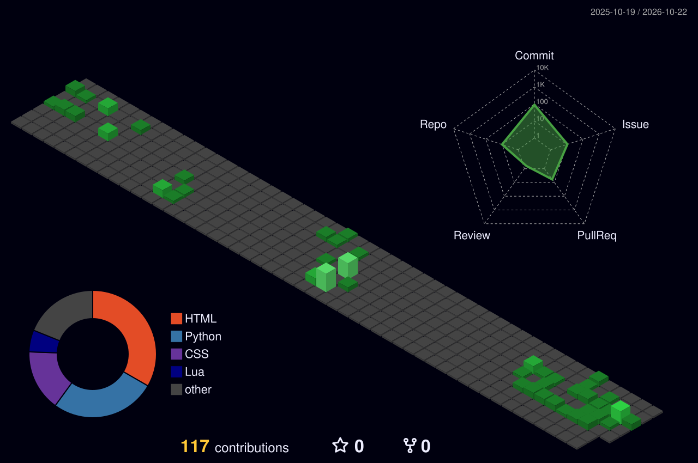

  

  

## TOOLS

- I'm a Data Science and Computer Science major at Chaminade University of Honolulu
- Currently working on my Geo-spatial Information certificate
- Contact me at calvin.small@student.chaminade.edu

